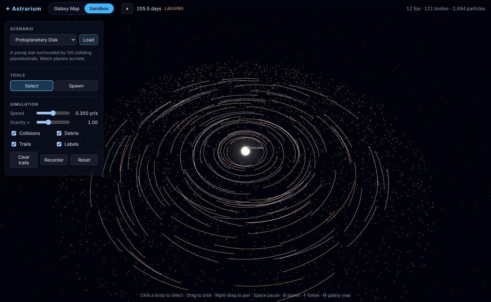
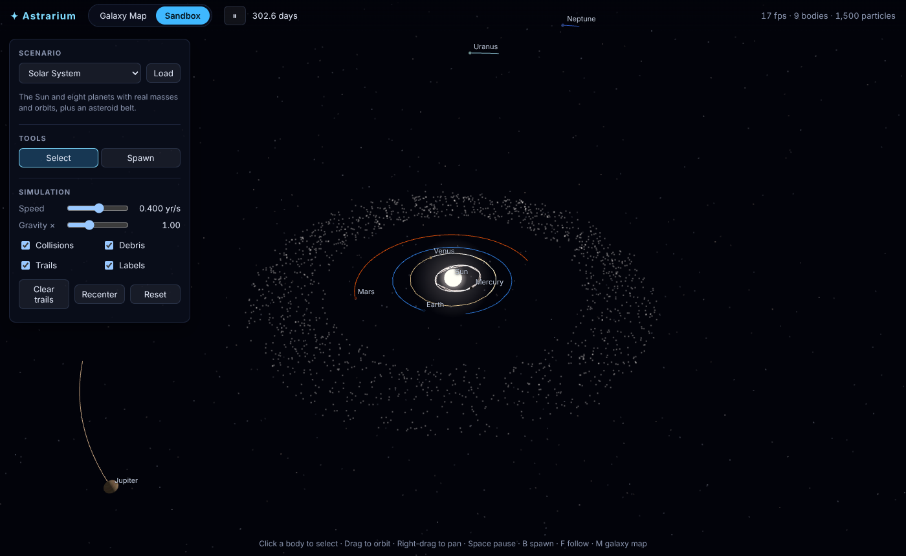
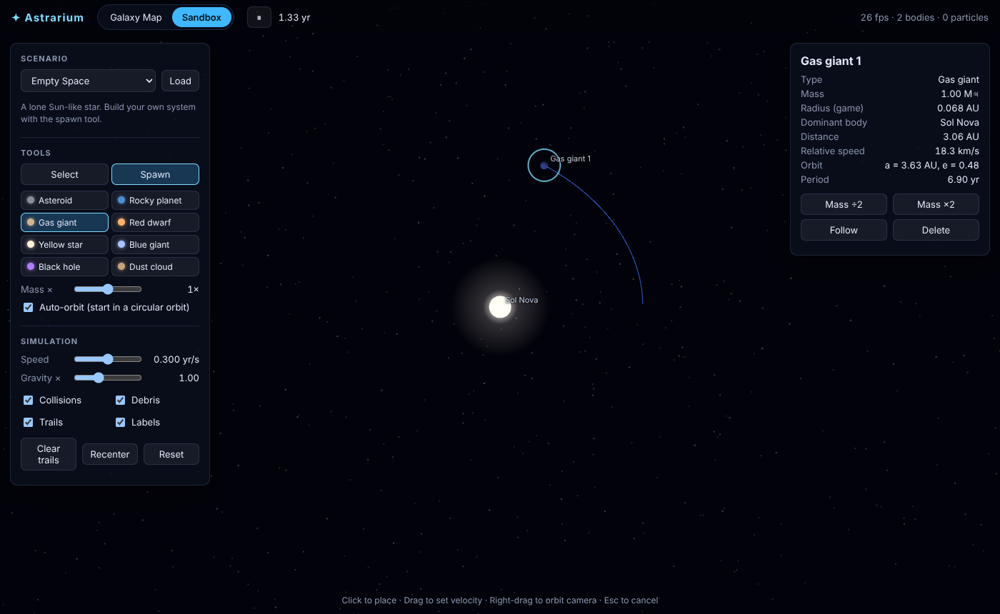

# Astrarium: a browser universe sandbox

Explore a procedurally generated galaxy, drop into any of its star systems, and then
break them: fling planets, ignite stars, and feed black holes. Everything runs in the
browser with real N-body gravity.

| Galaxy map | Protoplanetary disk |
| --- | --- |
|  |  |
| **Solar System** | **Spawn tool & orbit readout** |
|  |  |

```
npm install
npm run dev      # http://localhost:5173
npm test         # physics + procgen tests
npm run build    # static site in dist/
```

## What's in it

**Galaxy Map**
- Seeded spiral galaxies (2–5 arms, bulge, disk) with 30,000 selectable stars plus 60,000 background-glow points.
- Every star is deterministic: its seed produces the same spectral class, planets, moons, belts and companions every time.
- Click a star to inspect it, double-click to fly to it, then **Enter system** to load it into the sandbox.
- Share a galaxy with its URL: `#galaxy=<seed>`.

**Sandbox**
- N-body gravity: kick-drift-kick leapfrog with an adaptive global timestep (a fixed fraction of the shortest pairwise dynamical time).
- Collisions are inelastic merges that conserve mass and momentum, and throw off debris.
- Emergent transitions: enough mass ignites a planet into a star, and stars of 50 M☉ or more collapse into black holes.
- Thousands of massless test particles (asteroid belts, galaxy disks, debris) that feel gravity but don't exert it.
- Spawn tool: click to place, drag to set velocity, with **auto-orbit** and a live predicted trajectory.
- Select, follow, delete, and double or halve a body's mass. The info panel shows orbital elements (a, e, period).
- Controls for time speed (0.001–100 yr/s), a gravity multiplier, and toggles for collisions, debris, trails and labels.
- Presets: Solar System, Protoplanetary Disk, Binary Star, Figure-8 Three-Body, Rogue Star Flyby, Black Hole Feast, Galaxy Collision, Empty Space.

### Controls

| Input | Action |
| --- | --- |
| Drag / right-drag / scroll | Orbit / pan / zoom (in Spawn mode, right-drag orbits) |
| Click / double-click | Select / select and follow (Sandbox); select / fly to (Galaxy) |
| `Space` | Pause / resume |
| `V` / `B` | Select tool / Spawn tool |
| `F` | Follow the selected body |
| `Del` | Delete the selected body |
| `[` / `]` | Slower / faster |
| `M` | Switch between Galaxy Map and Sandbox |
| `Enter` | Visit the selected star (Galaxy) |
| `Esc` | Cancel / unfollow / deselect |

## Units and simplifications

- Simulation units are **AU, solar masses and years**, so `G = 4π²`.
- Body radii are **inflated** so they're visible and collide at solar-system scales. The same radius is used for rendering and collisions. Moons are only generated where they fit between this inflated surface and the planet's Hill sphere.
- Spectral-class frequencies are boosted for rare (O/B/A) stars to make the galaxy more varied.
- The galaxy map is a static, procedural catalogue. Only the sandbox is simulated.

## Project layout

```
src/
  sim/        physics: bodies, integrator & collisions, orbits, presets, trajectory prediction
  procgen/    seeded RNG, name generator, star-system and galaxy generators
  render/     Three.js views (galaxy map, system sandbox), body visuals, textures
  ui/         small DOM helpers
  app.ts      wires simulation, views, input and UI together
tests/        vitest suites for physics and procedural generation
```

The physics core (`src/sim`) and generators (`src/procgen`) have no rendering dependencies,
so they can be tested headlessly or ported to another engine.
