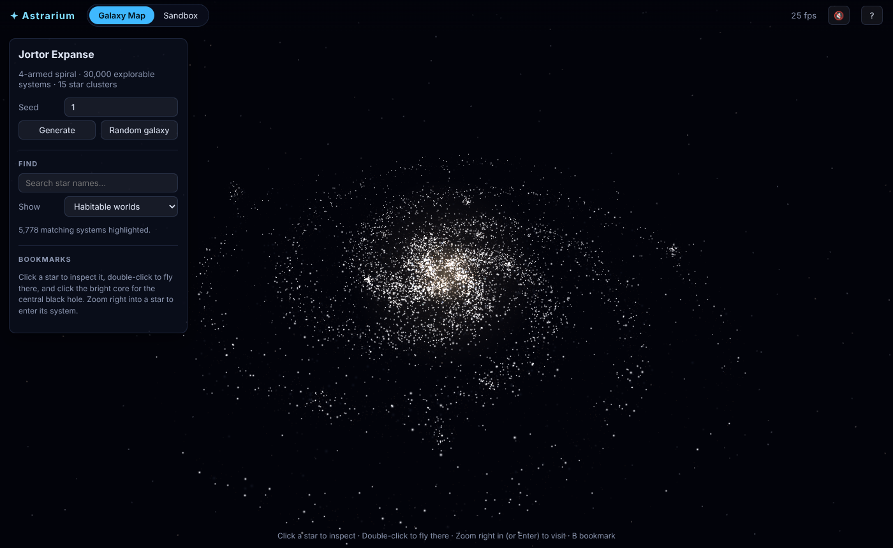
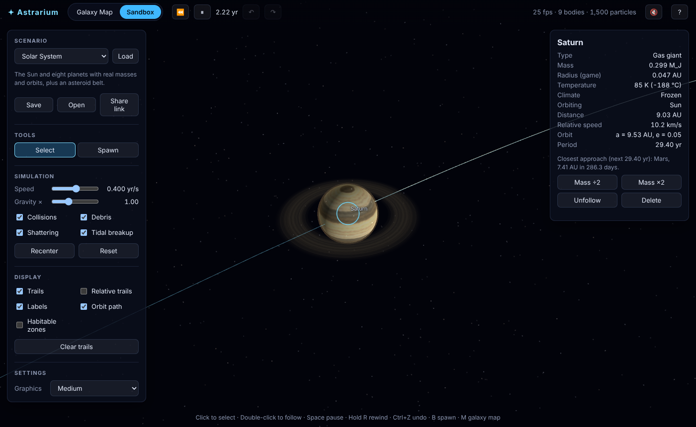
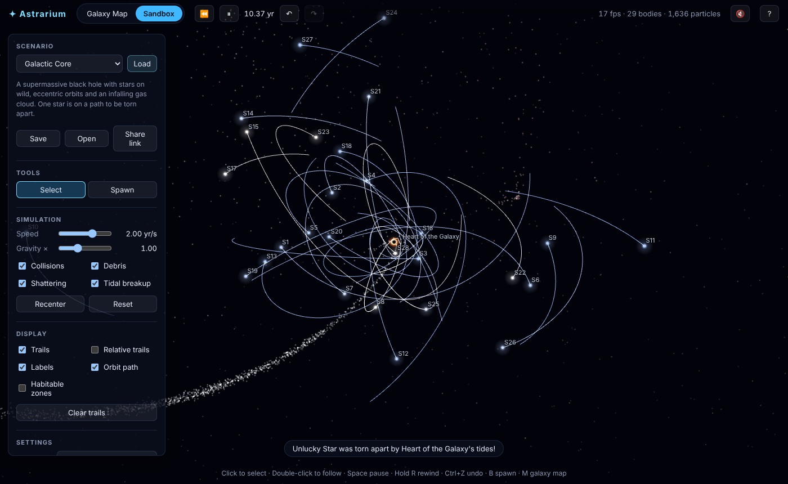

# Astrarium: a browser universe sandbox

Explore a procedurally generated galaxy, warp into any of its 30,000 star systems, and
then break them: fling planets, shatter worlds, tear moons into rings, detonate
supernovae, and feed black holes. Everything runs in the browser with real N-body gravity.

| Galaxy map | Habitable-world filter |
| --- | --- |
|  |  |
| **Saturn close-up** | **A moon torn into a ring** |
|  |  |
| **Giant impact** | **Galactic core** |
|  |  |
| **2,000-star cluster (Barnes–Hut)** | |
|  | |

## Run it

```
npm install
npm run dev        # http://localhost:5173
npm test           # physics, procgen and protocol tests
npm run build      # static site in dist/
```

### Put it online (GitHub Pages)

The repo includes `.github/workflows/deploy.yml`. To publish:

1. In the GitHub repo, go to **Settings → Pages** and set **Source** to **GitHub Actions**.
2. Push to `main` (or run the *Deploy to GitHub Pages* workflow manually from the **Actions** tab).
3. The site appears at `https://<user>.github.io/<repo>/`.

`.github/workflows/ci.yml` type-checks, tests and builds every push and pull request.

## Features

### Galaxy map
- Seeded spiral galaxies with 2–5 arms, a bulge, open and globular **star clusters**, glowing **nebulae**, dark **dust lanes**, and a **supermassive black hole** at the centre that you can visit.
- **30,000 explorable systems.** Each star's seed deterministically generates its spectral class, planets, moons, asteroid belts, companions and habitable worlds.
- **Search** by star name, and **filter** for habitable worlds, gas giants, moons, 6+ planets, binaries, asteroid belts, massive O/B stars, bookmarks or visited systems.
- **Bookmarks** and **visited** markers, saved per galaxy in your browser.
- **Seamless warps:** zoom right into a star to drop into its system, and zoom far out of a system to return to the galaxy at that star.
- Share a galaxy with its URL: `#galaxy=<seed>`.

### Physics
- **N-body gravity** with a kick-drift-kick leapfrog integrator and an adaptive timestep.
- **Barnes–Hut octree** switches on automatically above 160 bodies, so thousands of mutually attracting bodies stay interactive.
- **Runs in a Web Worker**, so the UI never stutters. Append `#worker=0` to the URL to run physics on the main thread instead.
- **Collisions:** slow impacts merge (mass and momentum conserved). Fast rocky impacts **shatter** into a remnant plus fragments that can re-accrete or become moons.
- **Tidal disruption:** bodies that pass inside another body's **Roche limit** are torn into debris streams and rings. Black holes shred stars.
- **Stellar evolution events:** planets ignite into stars, and stars of 8 M☉ or more can go **supernova**. A supernova leaves a neutron star or black hole and launches a shockwave that strips nearby planets. Neutron stars collapse to black holes above 2.5 M☉.
- **Climate model:** surface temperature from all nearby stars, climate classes from frozen to molten, habitable zones, and habitability checks.

### Sandbox tools
- **Spawn tool:** asteroids, planets, gas giants, stars, neutron stars, black holes and dust clouds. Click to place, drag to set velocity. **Auto-orbit** starts a body in a circular orbit, and a live **predicted trajectory** is drawn while you drag.
- **Inspect anything:** mass, temperature, climate, orbit (a, e, period), the selected body's **orbit ellipse**, Roche-limit warnings, and a **forecast** of the next close approach or **collision**.
- Follow a body, double or halve its mass, delete it, or detonate a massive star.
- **Hold-to-rewind**, plus **undo/redo** for every change.
- **Save and open** scene files, and **copy a share link**: the scene is compressed into the URL.
- Display options: trails (absolute, or relative to the followed body), labels, orbit paths and habitable zones.
- Physics toggles: collisions, debris, shattering and tidal breakup, plus a gravity multiplier and time speed from 0.001 to 100 yr/s.

### Looks and feel
- **Procedural planets:** oceans, continents and ice caps on temperate worlds, plus frozen, desert and molten (glowing lava) variants. Gas giants have turbulent bands, storms and rings, and planets get cloud layers and atmosphere glow. Detail is generated lazily for planets that are large on screen.
- Planets **change appearance as their temperature changes:** push one toward its star and watch it melt.
- Pulsar beams, accretion disks, supernova shockwave bubbles, and impact flashes.
- **Procedural sound:** an ambient drone plus synthesized impacts and explosions. It's off by default; turn it on with 🔇.
- **Graphics quality** presets: Low, Medium and High.
- First-run **tutorial** (press `?` to replay), **touch** support with double-tap, and a **mobile** layout.

### Scenarios
Solar System · Protoplanetary Disk · Giant Impact · Ring Maker · Binary Star · Figure-8 Three-Body · Rogue Star Flyby · Black Hole Feast · Supernova · Galactic Core · Star Cluster Collapse · Self-Gravitating Disk · Galaxy Collision · Empty Space

## Controls

| Input | Action |
| --- | --- |
| Drag / right-drag / scroll | Orbit / pan / zoom (in Spawn mode, right-drag orbits) |
| Click / double-click | Select / select and follow (Sandbox); select / fly to (Galaxy) |
| `Space` | Pause / resume |
| Hold `R` (or ⏪) | Rewind |
| `Ctrl+Z` / `Ctrl+Shift+Z` | Undo / redo |
| `V` / `B` | Select tool / Spawn tool (in the Galaxy view, `B` bookmarks) |
| `F` | Follow the selected body |
| `Del` | Delete the selected body |
| `H` / `O` / `T` | Toggle habitable zones / orbit path / trails |
| `[` / `]` | Slower / faster |
| `M` | Switch between Galaxy Map and Sandbox |
| `Enter` | Visit the selected star (Galaxy) |
| `?` | Tutorial |
| `Esc` | Cancel / unfollow / deselect |

## Units and simplifications

- Simulation units are **AU, solar masses and years**, so `G = 4π²`.
- Body radii are **inflated** so they're visible and collide at solar-system scales. Tidal limits therefore use nominal densities by body type rather than these game radii.
- Test particles (belts, debris, gas) are massless: they feel gravity but don't exert it. Mass lost to tidal debris isn't tracked.
- Spectral-class frequencies are boosted for rare (O/B/A) stars to make the galaxy more varied.
- The galaxy map is a static, procedural catalogue. Only the sandbox is simulated.

## Project layout

```
src/
  sim/        physics: bodies, integrator, Barnes–Hut octree, collisions, tides,
              supernovae, climate, presets, forecasts, snapshots, worker + protocol
  procgen/    seeded RNG, names, star-system and galaxy generators
  render/     Three.js views (galaxy, sandbox), body visuals, procedural textures, noise
  ui/         DOM helpers, history (rewind/undo), share links, bookmarks, tutorial
  audio.ts    WebAudio drone and effects
  app.ts      wires simulation, views, input and UI together
tests/        vitest suites
```

The physics core (`src/sim`) and generators (`src/procgen`) have no rendering dependencies,
so they run headlessly in tests and in the Web Worker.
